# llm-gateway for OpenWrt

The models a house runs on its own machines (Ollama on a desktop, llama-server or LM Studio on a
laptop) usually listen on every address with no key, and often answer any web page with
`Access-Control-Allow-Origin: *`. Every device on the network can use them, and so can any site a
visitor opens in a browser.

llm-gateway puts them behind the router:


- **One name for every model in the house**: `https://llm.lan:8760/v1`, OpenAI-compatible
  (`/v1/models`, `/v1/chat/completions`, `/v1/completions`, `/v1/embeddings`, streaming).
- **A key per device**, shown once and stored only as its SHA-256. A device sees and uses only the
  models it is given. Limits per minute and per request in flight.
- **HTTPS under the router's own CA.** A device trusts it once; the CA is name-constrained, so it
  can vouch for the gateway and nothing else.
- **The firewall does the rest.** The gateway listens only in the zones you name. `models-zone`
  puts the model machines into a zone that only the router reaches, with no internet unless you
  ask for it, so the gateway is the only way in.
- **No browser drive-by**: no wildcard origin, origins allowed per device, DNS rebinding refused.
- **Nothing leaves the house**: a backend outside the private ranges is refused, at load and on
  every connection.
- **A journal of who used which model**, in RAM, never holding a prompt, an answer or a key.

One static Go binary, about 7 to 9 MB, no database.

**Current release**, in the signed feed since 2026-11-01: `llm-gateway` 0.1.0-r2 for OpenWrt 25.12,
on `aarch64_cortex-a53` (GL.iNet Flint 2 and other Filogic routers), `arm_cortex-a7_neon-vfpv4`,
`mipsel_24kc` and `x86_64`. Feed: <https://taipanbox.github.io/openwrt-llm-gateway/>.

## Install

OpenWrt 25.12 with apk, from the signed feed. On the router, as root: trust the feed's key, check
it, add the feed for the router's own architecture, install.

```sh
wget -O /etc/apk/keys/llm-gateway.pem https://taipanbox.github.io/openwrt-llm-gateway/llm-gateway.pem
sha256sum /etc/apk/keys/llm-gateway.pem
echo "https://taipanbox.github.io/openwrt-llm-gateway/25.12/$(cat /etc/apk/arch)/packages.adb" >> /etc/apk/repositories.d/customfeeds.list
apk update && apk add llm-gateway
```

The sum must be `d5151976fb774d291b4954cce7ea86cf4cf25de6c616c3fbbf05fd5a531457fa`; if it is not,
delete the file and stop. apk then checks the index and the package against this key, with no
`--allow-untrusted`, and refuses a package signed by another key or damaged on the way. Without
the key apk ignores the feed. The service does nothing until it is configured. How the feed is
built, signed and checked: [docs/FEED.md](docs/FEED.md).

## Use

```sh
# the network where the model machines live becomes a zone only the router reaches
llm-gateway models-zone models

uci set llm-gateway.desktop=backend
uci set llm-gateway.desktop.url='http://10.60.0.10:11434/v1'
uci add_list llm-gateway.desktop.model='qwen3:14b'
uci set llm-gateway.main.enabled=1
uci commit llm-gateway
service llm-gateway restart

llm-gateway client add laptop -model qwen3:14b     # prints the key once, and the CA fingerprint
llm-gateway cert                                   # the CA a device trusts, once
```

On the device: base URL `https://llm.lan:8760/v1`, the key as the API key, and the router's CA
trusted ([below](#trust-the-routers-ca)). Agents on the router itself use
`http://127.0.0.1:8761/v1`, with a key as well. A device that is lost or given away loses its
access with `llm-gateway client remove <name>` and `service llm-gateway reload`.

## One request, check by check



The checks run in this order in [`gateway.go`](gateway.go), and the first one that fails answers.
A key is checked before anything about the request's body is read, and a model server is dialled
only after every check has passed, at an address inside the house; the client's key never goes
with the request, and the server's own key, where it has one, does.

## Trust the router's CA

The gateway's certificate is issued by a CA the router makes for itself on first start. A device
trusts that CA once; the gateway's own certificate under it is renewed without the device
noticing. The CA is name-constrained, and the constraint is critical: it can vouch for `llm.lan`
(the name the gateway serves, `llm.` and your LAN domain) and for addresses in `10.0.0.0/8`,
`172.16.0.0/12`, `192.168.0.0/16`, `127.0.0.0/8` and `fc00::/7`, and for no other name. So a
device that trusts it cannot be shown a forged certificate for a public site with it, even by
someone holding the CA's key.

Fetch the certificate from the router and check its fingerprint:

```sh
ssh root@192.168.1.1 "llm-gateway cert | sed -n '/BEGIN/,/END/p'" > llm-gateway-ca.crt
openssl x509 -in llm-gateway-ca.crt -noout -fingerprint -sha256
```

The SHA-256 fingerprint openssl prints must be the one on the first line of `llm-gateway cert` on
the router, which `client add` also prints as `CA to trust`. Then trust the file on each device.

**macOS**, for every user of the Mac:

```sh
sudo security add-trusted-cert -d -r trustRoot -k /Library/Keychains/System.keychain llm-gateway-ca.crt
```

or for your own user only, `security add-trusted-cert -r trustRoot -k
~/Library/Keychains/login.keychain-db llm-gateway-ca.crt`. In Keychain Access: File › Import Items
into the System keychain, double-click the certificate, open Trust and set it to Always Trust.

**Windows**, in PowerShell as administrator (the `ssh` client comes with Windows 10 and 11):

```powershell
ssh root@192.168.1.1 "llm-gateway cert | sed -n '/BEGIN/,/END/p'" | Out-File -Encoding ascii llm-gateway-ca.crt
certutil -f -addstore Root llm-gateway-ca.crt
```

or for the current user only, without administrator rights, `certutil -user -addstore Root
llm-gateway-ca.crt`; Windows asks to confirm.

**Linux.** Debian and Ubuntu (the file must be PEM and end in `.crt`):

```sh
sudo cp llm-gateway-ca.crt /usr/local/share/ca-certificates/llm-gateway-ca.crt
sudo update-ca-certificates
```

Fedora, and RHEL and its relatives:

```sh
sudo cp llm-gateway-ca.crt /etc/pki/ca-trust/source/anchors/
sudo update-ca-trust
```

**Android.** Copy the file to the phone, then Settings › Security & privacy › More security settings
› Encryption & credentials › Install a certificate › CA certificate, Install anyway, and pick the
file; the names of the menus vary between makers. Android warns that the owner of a CA could see
your data: for this CA that reaches `llm.lan` and the private ranges, as above. Apps that target
Android 7.0 (API level 24) or later trust only the system's CAs unless the app opts in to CAs a
user added, so some apps keep refusing the gateway's certificate.

**iPhone and iPad.** AirDrop or mail the file to the device and open it, then Settings › Profile
Downloaded › Install, within 8 minutes; with Stolen Device Protection on, do it at a familiar
location. Installing is not trusting: then Settings › General › About › Certificate Trust
Settings, and turn on full trust for `llm-gateway house CA …`.

**One program only**, leaving the system's list as it is:

- **Node** programs: `NODE_EXTRA_CA_CERTS=/path/to/llm-gateway-ca.crt`. It adds to Node's own list
  rather than replacing it, and is read once, when the process starts. Claude Code reads it too,
  and trusts the system's store as well, so after the system-wide step above it needs nothing.
- **Python**: `SSL_CERT_FILE=/path/to/llm-gateway-ca.crt` for the standard library and for HTTPX,
  `REQUESTS_CA_BUNDLE=/path/to/llm-gateway-ca.crt` for Requests. Both replace the default list
  rather than add to it, which suits a program that talks only to the gateway.
- **curl**: `curl --cacert llm-gateway-ca.crt https://llm.lan:8760/health` prints `ok`.

Those three were run against the gateway's own TLS code under a fresh CA: each refused the
certificate without the CA and accepted it with
([evidence](docs/evidence/ca-trust-clients-2026-11-01.txt)).

## Hermes on the router

[hermes-openwrt](https://github.com/TAIPANBOX/hermes-openwrt) runs Hermes Agent on the router
itself. From `hermes-agent` 0.21.5-r20, one option makes it take its model from this gateway:

```sh
uci set hermes.main.llm_gateway=1 && uci commit hermes && service hermes-agent restart
```

On every start it makes sure the gateway has a client named `hermes` for the model in
`hermes.main.model`, keeps that client's key in a file only root can read, and talks to the gateway
on the router's own loopback, `http://127.0.0.1:8761/v1`. Details:
[docs/providers.md](https://github.com/TAIPANBOX/hermes-openwrt/blob/main/docs/providers.md#a-model-on-a-computer-in-the-house-through-llm-gateway).
It has run that way on a GL.iNet Flint 2 ([evidence](docs/evidence/flint2-hermes-2026-11-01.md)).

## The OpenWrt family

Packages that run on the OpenWrt router itself:

- [hermes-openwrt](https://github.com/TAIPANBOX/hermes-openwrt): Hermes Agent as a native OpenWrt
  service (apk, procd, UCI, no Docker), with a LuCI page and Telegram; changes with a high impact
  wait until you approve them.
- [openwrt-mcp](https://github.com/TAIPANBOX/openwrt-mcp): an MCP server on the router, six generic
  tools over ubus, standing-policy authorisation, and config changes with an armed rollback timer.
- [rollcall](https://github.com/TAIPANBOX/rollcall): the routers of one site watch each other and
  report incidents through whichever of them is still online.
- llm-gateway, this repository: the house's model servers behind one name on the router.

## How it is checked

Every behaviour above is a scenario in [`features/`](features), bound to the tests that prove it;
a gate checks the binding both ways. The security properties are listed with their tests, gates
and mutants in [`CLAUDE.md`](CLAUDE.md). The firewall behaviour is run on a real OpenWrt 25.12
router in a virtual lab: [`scripts/vlab-e2e.sh`](scripts/vlab-e2e.sh), results in
[`docs/evidence/`](docs/evidence). The feed is installed from in the same lab with OpenWrt's own
apk, with the key, without it, with another key and with a damaged package
([docs/FEED.md](docs/FEED.md)). Design: [`docs/DESIGN.md`](docs/DESIGN.md).

## License

MIT
